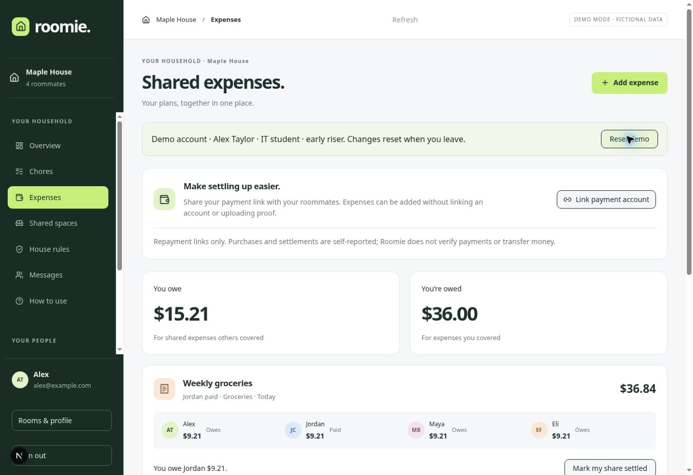
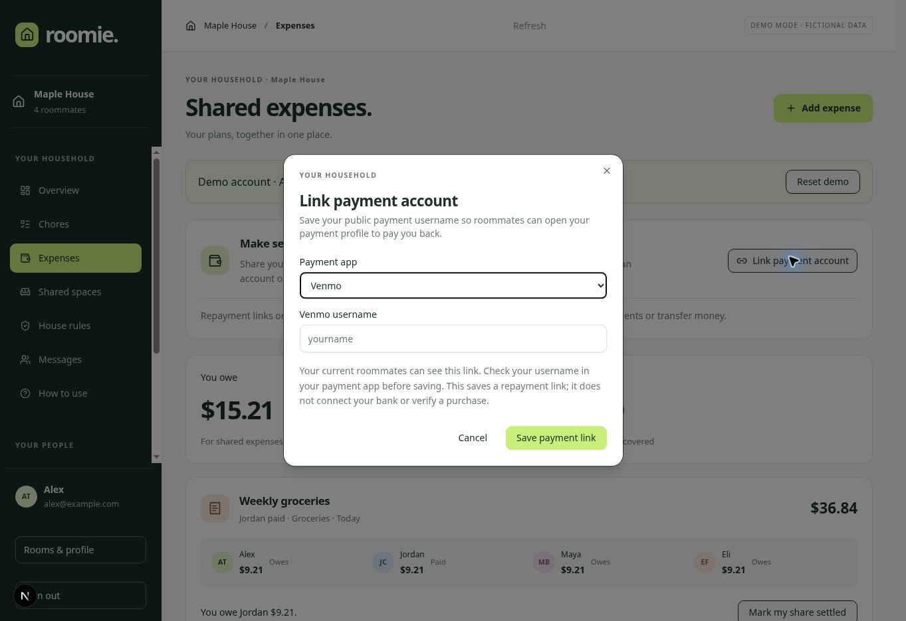
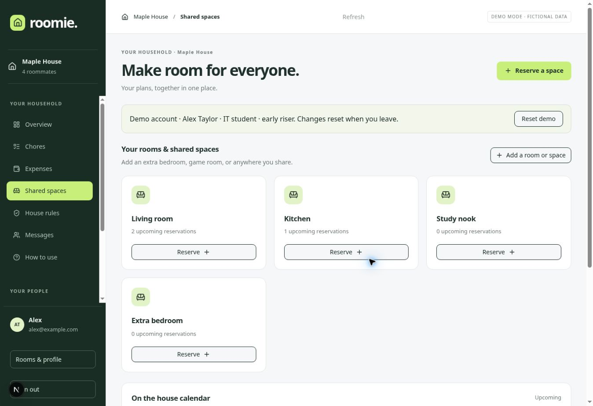
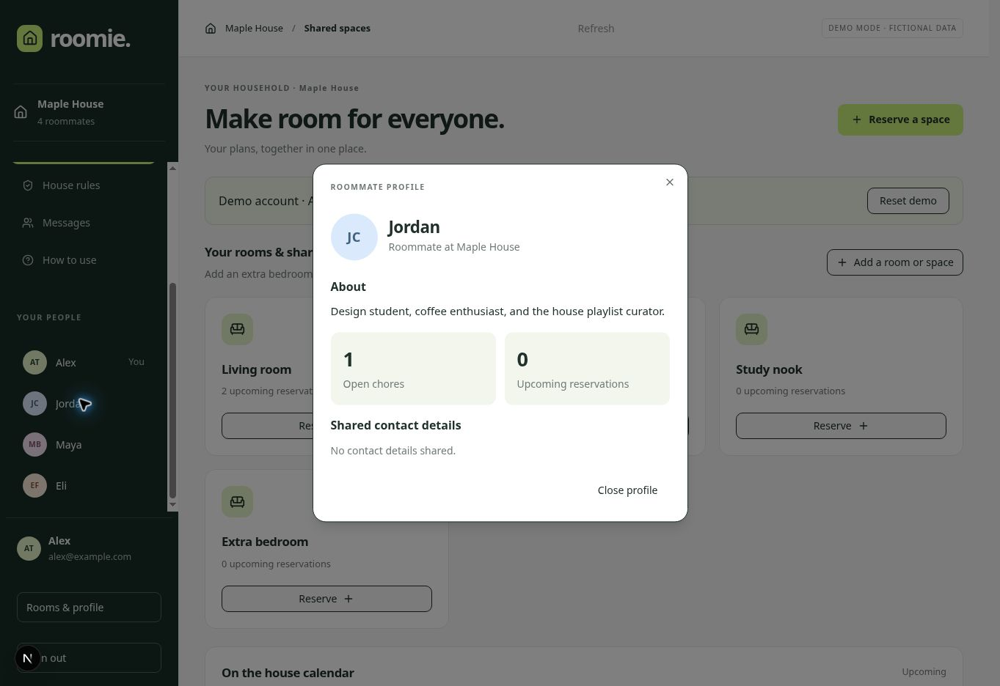

# Roomie feature update — November 22, 2026

Implemented on the `roomie-payment-spaces-profiles` branch. See [pull request #1](https://github.com/SeanSpon/projectforit/pull/1) for the complete change description and validation.

The screenshots below show the implemented interface in local Demo Mode using fictional residents. They are not screenshots of a merged production release. No real payment account or private contact details appear.

## Expenses: Link payment account

## Payment link setup

## Custom reservable rooms

## Clickable roommate profiles

## Validation

- TypeScript check passed.
- Next.js production build passed.
- 166 integration checks passed on a separate Neon test branch.
- Browser walkthrough covered expense entry without proof, a sample repayment link, adding and booking an extra bedroom, and opening a roommate profile.

Payment accounts are public repayment links; Roomie does not connect banks, verify payments, or transfer money. Profile contacts follow existing sharing preferences. Custom rooms are reservable spaces inside a household.
